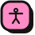
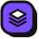

  

  

  
  
  
  
  

 

## &nbsp; Live GitHub stats

  
  

  
  

  

 

## &nbsp; Dev ID

 

## &nbsp; About me

I'm **Saikot Islam Abir**, a fullstack developer with a strong **frontend specialty**. I build responsive, animated interfaces with React and Next.js, I'm comfortable on the backend with Node.js and Express, and I like turning rough ideas into products that actually ship.

My rule is simple: **software should be both functional and beautiful.** That's why my own portfolio has eight themes, a command palette, Matrix-style page transitions, a built-in arcade and a few secrets you have to find yourself.

 

## &nbsp; How I work

| | |
|---|---|
|  **Performance first** | I watch the metrics and care about every millisecond. |
|  **Clean code** | Code is read far more than it is written, so I keep it self-documenting. |
|  **Open source** | The best software is built together, so I give back where I can. |
|  **Accessibility** | I build with a11y and diverse users in mind from day one. |
|  **Ship fast** | Perfect is the enemy of shipped. I iterate, collect feedback and improve. |

 

## &nbsp; Skills at a glance

 

## &nbsp; Tech stack

 <b>Frontend</b>

 

  

  
  
  
  
  

 <b>Backend</b>

 

  

  
  
  

 <b>Databases</b>

 

  

 <b>Cloud and DevOps</b>

 

  

 <b>AI and ML</b>

 

  

  
  
  
  

 <b>Tools</b>

 

  

 

## &nbsp; Currently learning

  
  
  
  
  

 

## &nbsp; Featured projects

  

 

## &nbsp; The arcade

My portfolio has a built-in arcade, so visitors can take a break and play:

  
  
  
  
  
  
  
  
  

 

## &nbsp; Certificates

 

## &nbsp; Contribution snake

  <picture>
    <source media="(prefers-color-scheme: dark)" srcset="https://raw.githubusercontent.com/saikotportal/saikotportal/output/github-snake-dark.svg"/>
    <source media="(prefers-color-scheme: light)" srcset="https://raw.githubusercontent.com/saikotportal/saikotportal/output/github-snake.svg"/>
    
  </picture>

 

## &nbsp; Off-duty

When I'm not coding I'm contributing to open source, writing technical articles, playing **CoD Mobile**, experimenting with generative art, or drinking black Ethiopian coffee.

 

## &nbsp; Work with me

  Open to <b>freelance</b>, <b>contracts</b> and <b>full-time remote roles</b>, anywhere in the world. 
  Based in Bangladesh (UTC+6) · English, Bengali, Hindi.

  
  
  

<h3 align="center">Thanks for stopping by. Crafted with ♥ by Saikot Islam Abir</h3>

  

