

  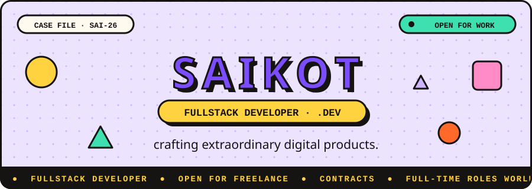

  

  <a href="https://saikot.dev">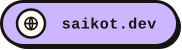</a>
  <a href="https://github.com/saikotportal">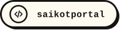</a>
  

  
  

## &nbsp; Live GitHub stats

  
  

  
  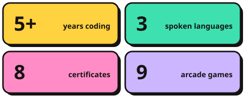

  <picture>
    <source media="(prefers-color-scheme: dark)" srcset="https://raw.githubusercontent.com/saikotportal/saikotportal/output/github-snake-dark.svg"/>
    <source media="(prefers-color-scheme: light)" srcset="https://raw.githubusercontent.com/saikotportal/saikotportal/output/github-snake.svg"/>
    
  </picture>

## &nbsp; About me

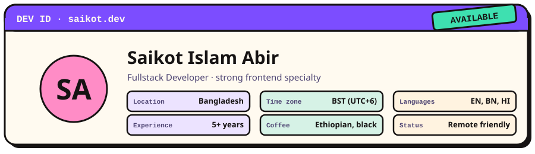

I'm **Saikot Islam Abir**, a fullstack developer with a strong **frontend specialty**. I build responsive, animated interfaces with React and Next.js, work comfortably in Node.js and Express, and turn rough ideas into products that ship. My rule is simple: **software should be both functional and beautiful.** When I'm off duty I contribute to open source, write technical articles, play CoD Mobile, experiment with generative art and drink black Ethiopian coffee.


## &nbsp; How I work

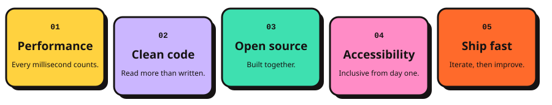

## &nbsp; Skills and stack



  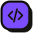 <b>Frontend</b> 
   
  
  
  
  

   <b>Backend</b> 
   
  
  

   <b>Databases</b> 
  

   <b>Cloud and DevOps</b> 
  

   <b>AI and ML</b> 
   
  
  
  
  

   <b>Tools</b> 
   
  
  

  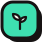 <b>Learning next</b> 
  
  
  
  
  

## 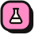&nbsp; Featured projects

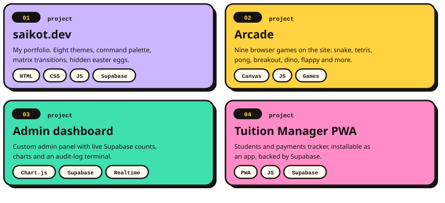

  The arcade on my site has 9 games to play: Snake, Tetris, Pong, Breakout, Dino, Flappy, Asteroids, Invaders and Tower. 
  <a href="https://saikot.dev/projects"><b>See all projects →</b></a>

 <b>Certificates (8)</b> &nbsp;click to open

 
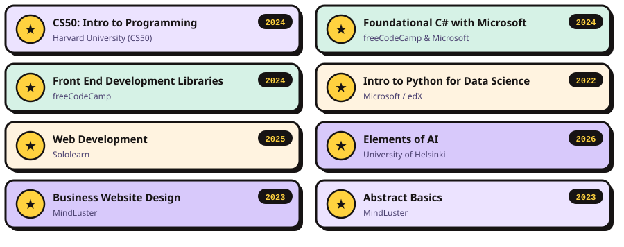

## 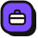&nbsp; Work with me

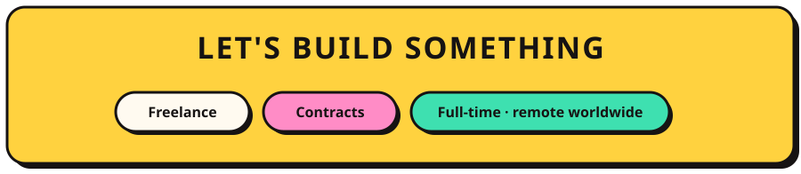

  Open to <b>freelance</b>, <b>contracts</b> and <b>full-time remote roles</b>, anywhere in the world. 
  Based in Bangladesh (UTC+6) · English, Bengali, Hindi.

  
  <a href="https://saikot.dev">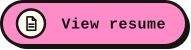</a>
  

<h3 align="center">Thanks for stopping by. Crafted with ♥ by Saikot Islam Abir</h3>

  

